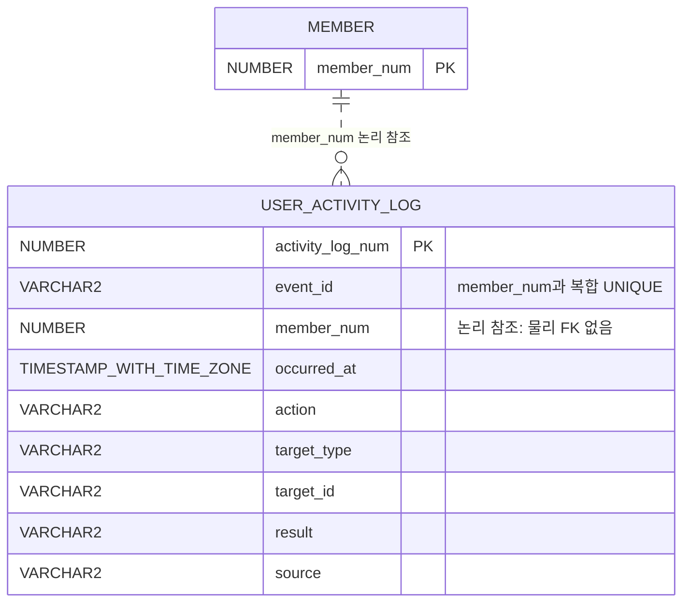

# 사용자 활동 로그 ERD 설계

상태: 생성 SQL 준비 완료. 실제 Oracle 반영 여부는 별도 확인 필요.
기존 merge8.vpp와 애플리케이션 코드는 변경하지 않는다.

## 관계

위 관계는 물리 FK가 아닌 논리 관계다. 탈퇴로 MEMBER 행이 삭제된 뒤에도 로그는 남을 수 있다.
기존 login_log와 직접 FK를 연결하지 않으며, 사용자 전체 이력은 member_num으로 연결한다.

## 컬럼

| 컬럼 | Oracle 타입 | 필수 | 의미 |
|---|---|---|---|
| activity_log_num | NUMBER(19,0) | Y | 시퀀스로 생성하는 PK |
| event_id | VARCHAR2(36 CHAR) | Y | 이벤트 UUID |
| member_num | NUMBER(19,0) | Y | 인증된 행위자 번호 |
| occurred_at | TIMESTAMP(6) WITH TIME ZONE | Y | 이벤트 발생 시각 |
| action | VARCHAR2(60 CHAR) | Y | 활동 코드 |
| target_type | VARCHAR2(40 CHAR) | Y | 대상 종류 |
| target_id | VARCHAR2(100 CHAR) | Y | 대상 번호 또는 코드 |
| result | VARCHAR2(20 CHAR) | Y | SUCCESS / FAILURE |
| source | VARCHAR2(20 CHAR) | Y | CLIENT / SERVER |

회원 번호의 실제 타입은 운영 DB의 MEMBER.MEMBER_NUM 정의와 대조한다.
회원 삭제를 막거나 로그를 함께 삭제하지 않도록 물리 FK는 두지 않는다.
탈퇴 후 로그 보관 기간과 익명화 정책은 운영 정책으로 별도 확정한다.

## 저장 규칙

- activity_log_num은 user_activity_log_seq.NEXTVAL로 생성한다.
- UNIQUE(member_num, event_id)로 같은 이벤트의 중복 저장을 방지한다.
- occurred_at에는 기본값을 두지 않는다. 발생 시각을 명시적으로 전달한다.
- CLIENT 시각은 브라우저가 보고한 값이며, SERVER 시각과 신뢰 수준이 다르다.
- target_id가 문자열이므로 숫자 대상과 화면 코드를 함께 저장할 수 있다.
- 대상 번호를 모르는 실패는 target_type=OPERATION, target_id=활동 코드로 기록한다.
- target_type/target_id는 여러 테이블을 가리키므로 물리 FK를 두지 않는다.
- 회원 식별 불가 요청과 비회원은 이 테이블에 저장하지 않는다.
- 비밀번호, 토큰, 이메일 원문, 질문/답변 본문, 문서 본문은 저장하지 않는다.

## 1차 이벤트

| action | target_type | target_id | source |
|---|---|---|---|
| PAGE_VIEW | PAGE | HOME / GROUP_LIST / SELFSTUDY | CLIENT |
| GROUP_JOIN | GROUP | 그룹 번호 | SERVER |
| QUIZ_SUBMIT | QUIZ_SESSION | 세션 번호 | SERVER |
| QUIZ_GENERATE | QUIZ_SESSION | 생성된 세션 번호 | SERVER |
| CHAT_MESSAGE_PROCESS | CHAT_SESSION | 대화 세션 번호 | SERVER |

업무 이벤트의 result는 SUCCESS 또는 FAILURE다. PAGE_VIEW의 SUCCESS는 화면 진입 보고를 뜻한다.

## SQLGate 실행 순서

1. 프로젝트 애플리케이션 스키마로 연결한다.
2. user_activity_log.sql 맨 위의 SELECT 두 개를 먼저 선택 실행한다.
3. 스키마가 맞고 동명 테이블·시퀀스가 없을 때만 CREATE/COMMENT 문을 실행한다.
4. 맨 아래 조회문으로 컬럼·제약조건·시퀀스·인덱스를 확인한다.

Oracle DDL은 암묵적 COMMIT을 일으킨다. 파일에 DROP 또는 기존 객체 변경 문은 포함하지 않았다.
이 문서와 SQL 작성은 실제 DB 테이블 생성 완료를 의미하지 않는다.
