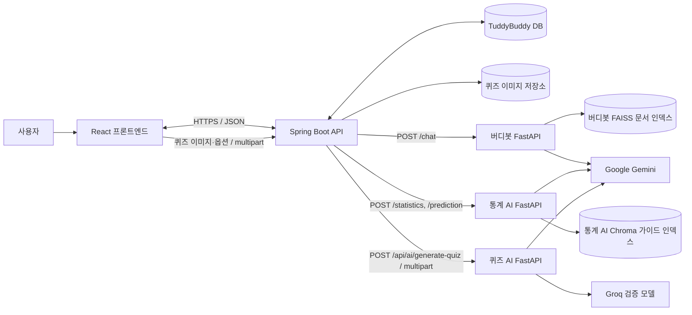
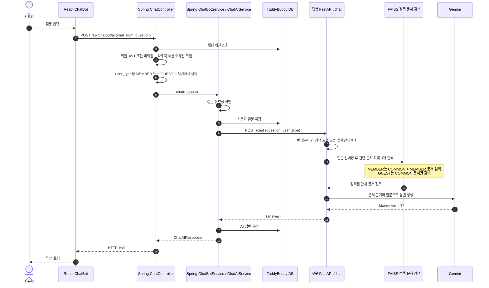
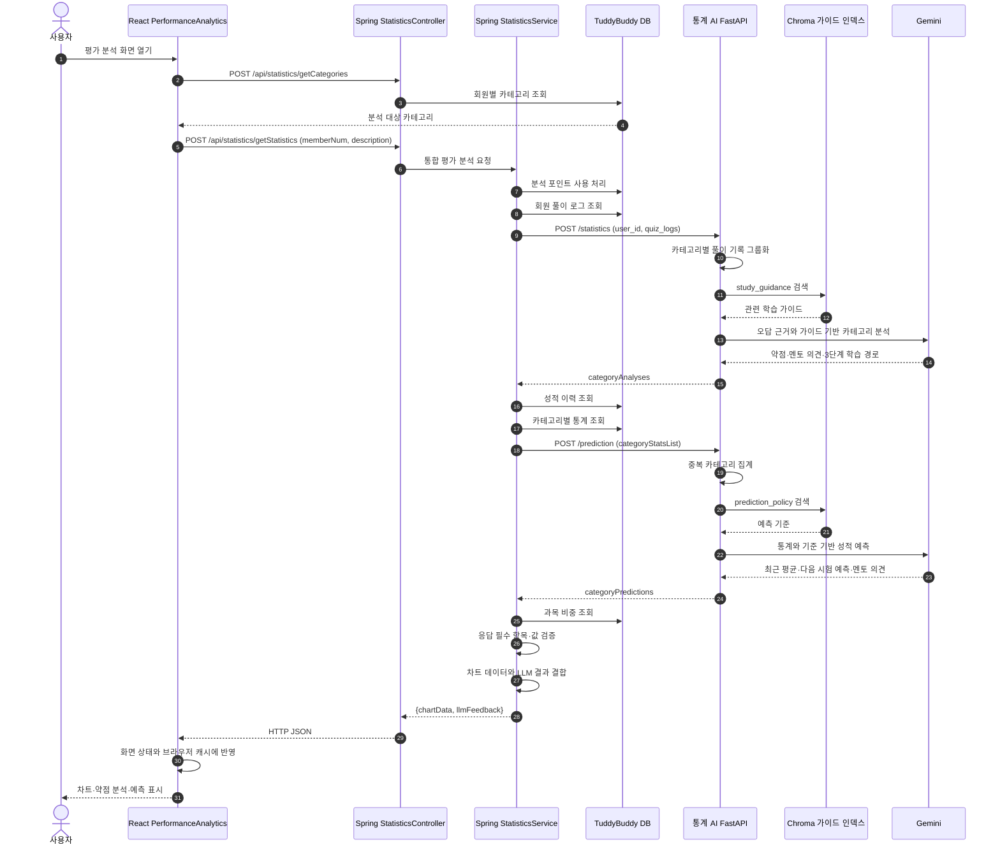
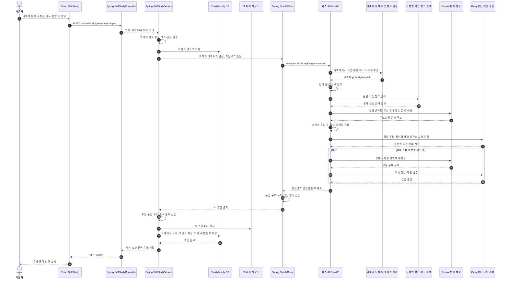

# TuddyBuddy AI 기능 아키텍처

> 목적: AI 관련 기능이 프론트엔드에서 시작해 Spring 백엔드, AI 서버, 외부 AI·검색 구성요소를 거쳐 결과로 돌아오는 구현 흐름을 설명한다.
> 기준: 현재 TuddyBuddy 저장소와 전달된 `chatbot-ai.zip`, `TuddyBuddy_statistics_llm (2).zip`, `quiz-ai-server-main.zip`의 코드 구조.

## 1. AI 기능 통합 구조

### 경계와 통신

| 구간 | 통신 | 역할 |
|---|---|---|
| React ↔ Spring Boot | HTTP JSON; 퀴즈 생성은 multipart | 사용자 입력, 인증·검증, 결과 화면 표시 |
| Spring Boot ↔ 버디봇 FastAPI | 동기 HTTP `POST /chat` | 회원 유형을 포함한 질문 전달, AI 답변 반환 |
| Spring Boot ↔ 통계 FastAPI | 동기 HTTP `POST /statistics`, `POST /prediction` | 풀이 로그 또는 집계 통계를 전달하고 구조화된 분석 결과 수신 |
| Spring Boot ↔ 퀴즈 FastAPI | 동기 HTTP multipart `POST /api/ai/generate-quiz` | 이미지와 퀴즈 조건을 전달하고 검증된 문제 세트 수신 |
| AI 서버 ↔ 모델·검색 인덱스 | 서버 내부 호출 | RAG 검색, 문제·분석 생성, 생성 결과 검증 |

세 AI 요청은 현재 코드상 요청 하나에 응답 하나를 반환하는 동기 흐름이다. SSE나 WebSocket 스트리밍 흐름은 이 AI 아키텍처 범위에 포함하지 않는다.

## 2. 버디봇 안내 대화

**책임 분리:** Spring은 세션 권한 확인과 대화 내역 저장을 담당한다. FastAPI는 PDF로 만든 FAISS 인덱스에서 접근 수준에 맞는 안내 문서를 검색하고 Gemini로 답변을 만든다. AI 서버 통신 실패 또는 빈 응답은 Spring에서 서비스 이용 불가 응답으로 처리한다.

## 3. 평가 분석 및 성적 예측

**책임 분리:** Spring은 회원 데이터 조회, 포인트 처리, 분석용 요청 구성, AI 응답 검증과 차트 데이터 결합을 담당한다. FastAPI는 입력을 카테고리 단위로 정리하고 Chroma에서 가이드를 찾은 뒤 Gemini에 구조화 응답을 요청한다. `/statistics`와 `/prediction`은 별도 동기 호출이다.

## 4. 이미지 기반 AI 퀴즈 생성

**책임 분리:** Python AI 서버가 문제 생성과 자체 검증을 마친 뒤 결과를 반환한다. Spring은 반환값을 다시 검증하고, 이미지 파일 저장과 포인트 차감·세션·문제 데이터 저장을 처리한다. AI 생성 또는 응답 검증에 실패하면 저장 단계로 넘어가지 않는다. DB 저장 트랜잭션에서 오류가 나면 해당 DB 작업은 롤백된다.

## 5. 공통 다이어그램 표기 양식

기능 상세도는 다음 요소를 같은 순서로 표시한다.

1. **사용자 동작과 화면:** 어떤 화면에서 무엇을 입력하거나 실행하는가.
2. **프론트 ↔ 백엔드 계약:** API 경로, HTTP 메서드, JSON 또는 multipart 입력.
3. **Spring 처리:** 인증·소유권 확인, 유효성 검사, DB 읽기·쓰기, 트랜잭션.
4. **외부 AI 처리:** AI API, 모델, RAG 검색소스, 결과 검증과 재시도.
5. **응답과 실패 흐름:** 화면에 돌아오는 결과, 사용자 안내, 저장 여부.

일반적인 단순 CRUD는 이 상세 흐름과 같은 형태로 반복 작성하지 않고 기능 목록이나 공통 CRUD 표로 묶는다. 독립 다이어그램은 외부 연동, 비동기 통신, 인증 분기, 생성 결과 검증·재시도처럼 구현 흐름이 달라지는 기능에만 둔다.

## 확인할 점

- 첨부 ZIP은 AI 서버 구현을 확인하는 자료로 사용했고, 서비스 키나 `.env` 값은 문서에 포함하지 않았다.
- 퀴즈 AI 서버 코드는 이미지 분석 이후 RAG·생성·검증 단계를 제공하는 것으로 정리했다. 실제 배포 환경의 모델·엔드포인트 설정은 환경 설정에 따라 달라질 수 있다.
- 현재 다이어그램은 구현 흐름을 설명한다. 배포 서버·네트워크·운영 환경 구성도는 별도 인프라 아키텍처로 분리한다.
